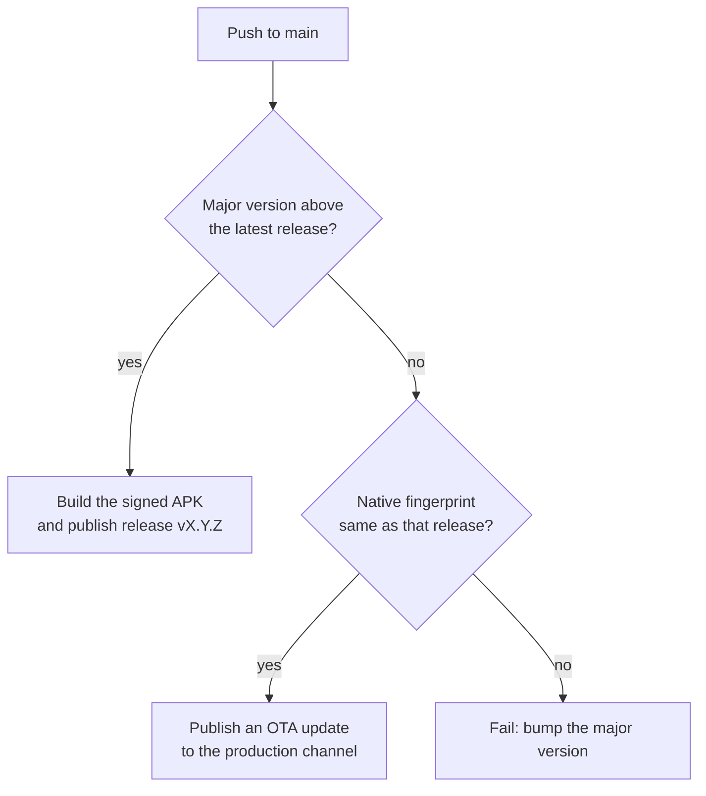

# Agent Notes

Context for coding agents working in this repo. Read [README.md](README.md) for layout and scripts first. Expo-specific rules live in [app/AGENTS.md](app/AGENTS.md).

## Where Things Stand

- Specs are HTML under [.docs/](.docs/): product requirements, POC requirements, and the POC task plan. Task IDs (T1, C2, A6, I1, …) come from [.docs/poc-tasks.html](.docs/poc-tasks.html), and branches are named after them (`a6-session-flow`). [.docs/minigames.html](.docs/minigames.html) shows which items have no minigame yet and the order to build the next ones.
- The design system lives in [.docs/design/](.docs/design/). Each component has a `README.md` and a `preview.html`. Tokens are in `tokens.json`.
- `content/out/skills.json` holds the generated K–6 skill graph. `content/out/bundle.json` holds the generated stories and items, scoped to the targets in `content/bundle-scope.json` plus their prerequisites. Generation and its checks live in `content/src/generate/`.
- `content/scenes.json` maps item ids to sharing scenes, `content/slices.json` to slice scenes, `content/join.json` to join scenes, and `content/hops.json` to frog paths on number lines. `npm run content:scenes`, `content:slices`, `content:join`, and `content:hops` write them with one cached LLM call per skill, then add them to the bundle. Code keeps a scene only when its answer matches the item's, so a regenerated item loses a stale scene.
- Fraction pictures say `picked`, not `shaded`, and name a `food` when the story does. The generator's prompts and cache still say "shaded". `content/src/generate/app-words.ts` rewords and picks the food after review, so cached calls keep their keys.
- Every bundle write also splits it into `content/out/packs/`: `core.json` with the skill graph, one pack per subject and grade, and `manifests/<coreHash>.json`. The files are minified because their hashes cover the exact bytes. Run `npm run content:packs` after editing `bundle.json` by hand, or a content test fails.
- The app plays `content/out/bundle.json` through `loadBundle()` in `app/src/content/loadBundle.ts`.
- Family devices run a release-signed APK from a GitHub release and get JS and content changes over the air. CI does both. See [Versions and Releases](#versions-and-releases) and [docs/install-android.md](docs/install-android.md).

## Code Map

- `shared/src/engine/` — learner engine: mastery, unlocks, next step. Pure TypeScript.
- `shared/src/placement/` — adaptive placement probe.
- `shared/src/speech/` — `toSpeech` reads math formatting aloud.
- `shared/src/scene.ts` — sharing scenes: what an item asks, its things and containers, and `sceneProblems`, which checks a scene against its item.
- `shared/src/slices.ts` — slice scenes: one food cut into equal slices that get picked, eaten, cut, shared, or compared. `sliceProblems` checks a scene against its item.
- `shared/src/hops.ts` — the frog's path along a number line after a check. `defaultHops` plans one from the line's start when an item has none.
- `shared/src/game.ts` — `GAMES`, the registry of minigames by `kind`. Each has its scene schema and the check `check-bundle` runs. An item plays at most one, in its `game` field.
- `shared/src/join.ts` — join scenes: things that come into a ten-frame, leave it, or get counted, set aside, or moved to make 10. `joinProblems` checks a scene against its item and its picture.
- `app/src/design/` — the design system in code: tokens, Baloo 2 and Atkinson Hyperlegible fonts, the line icons, and kid building blocks like `KidButton`, `KidScreen`, and `AvatarDisc`. Style new screens from here, not with raw colours.
- Kid-zone code imports `Text` from `app/src/design/Text`, not `react-native`. It swaps in Lexend for a child with the dyslexia-friendly font on, and ESLint enforces it.
- `app/src/session/` — the kid session controller: placement, then reviews, probes, and lessons. A finished check or review shows a `check-end` view before the next step. `buildTrail` picks the stops the child home draws.
- `app/src/storage/` — expo-sqlite with migrations and a Zod-validated repository. Tests run it on Node's SQLite (`storage/testing/`).
- `app/src/parent/` — PIN-gated parent area. `*.native.ts` files hold the phone versions. On web the PIN hash goes in the `settings` table, since expo-secure-store has no web support.
- `app/src/learning/` and `app/src/narration/` — item screens and expo-speech narration. After a check, the number line plays the frog's path, then shows the feedback.
- `app/src/learning/minigames/` — the sharing minigame and `GameFrame`, the prompt, answers, and feedback every minigame shares. Any item whose `game.kind` is `share` plays there instead of its usual screen. It allows retries during a lesson's check, and plays out the first answer then moves on when `measuring`.
- `app/src/learning/food/` — food art for fraction pictures, and the slices minigame. Any item whose `game.kind` is `slices` plays there.
- `app/src/learning/join/` — the join-and-leave minigame on a pond, a bus, wires, or a tray. Any item whose `game.kind` is `join` plays there.
- `/dev/learning` is a preview of every item type. `/dev/share`, `/dev/slices`, `/dev/join`, and `/dev/hops` play one item per kind of question. `/dev/check-end` shows each screen that ends a check or review. They show when `__DEV__` is true or the build sets `EXPO_PUBLIC_E2E=1`.

## Checking Your Work

Run what CI runs, in this order, before calling a task done:

```sh
npm run lint && npm run format:check && npm run typecheck && npm test && npm run build
```

To see the app, run `npm run dev` and open `http://localhost:8081`. Drive it with Playwright MCP and save screenshots under `.playwright-mcp/` (gitignored). The web build keeps its SQLite data in the browser, so clear site data for `localhost:8081` to start from a fresh install.

## Versions and Releases

The app version is `expo.version` in [app/app.json](app/app.json). Its major number is the runtime version, and an OTA update only reaches APKs with the same runtime version.

**Bump the major version in any PR that needs a reinstall.** That's any change to the native side:

- Adding, removing, or upgrading a package with native code (`npx expo install`).
- An Expo SDK or React Native upgrade.
- Changes to `app.json`, `app.config.js`, or config plugins, other than the version.

You don't have to spot these yourself. `scripts/release.mjs` compares the native fingerprint with the one saved in the latest release, and CI fails the PR if it changed without a major bump. Minor and patch bumps are optional. Use them to mark a change in **About this app**.



Before either path, `npm run content:publish` uploads the content packs to Cloudflare R2. Packs go first and `manifests/<coreHash>.json` last, so a manifest never names a missing pack. Add `-- --dry-run` to list the files without uploading.

CI needs these repo secrets:

- `EXPO_TOKEN`.
- The release key as `RELEASE_KEYSTORE` (base64), `RELEASE_STORE_PASSWORD`, `RELEASE_KEY_ALIAS`, and `RELEASE_KEY_PASSWORD`.
- An R2 API token with write access to the bucket, as `R2_ACCOUNT_ID`, `R2_ACCESS_KEY_ID`, `R2_SECRET_ACCESS_KEY`, and `R2_BUCKET`. Until all four are set, CI skips the upload with a warning. Setting only some fails the run.

## Gotchas

- **Stale `node_modules`.** Work often happens in `.claude/worktrees/`, which install their own deps. The main checkout can then miss packages a merged branch added, and Metro fails with `Unable to resolve "expo-crypto"`. `npm run dev` reinstalls when `package-lock.json` is newer than `node_modules/.package-lock.json`. Otherwise run `npm install`.
- **Port 8081 on Windows.** `Get-NetTCPConnection` can report Metro's listener with state `Closed`, and `netstat` may not list it at all. Find the owner by port, not by state.
- **Adding app deps.** Use `npx expo install <pkg>` from `app/`, never plain `npm install`, so versions match Expo SDK 58.
- **ESLint 10.** `eslint-plugin-react` can't auto-detect the React version, so `eslint.config.mjs` pins it. Bump it there when React changes.
- **Curriculum text.** `content/sources/` stays byte-for-byte as fetched. Prettier ignores it. Don't reformat it.
- **LLM calls.** `npm run content:graph` and `npm run content:generate` use the Claude Code CLI in headless mode by default. Responses cache in `content/cache/llm/`, which is committed, so reruns are free unless a prompt changed.
- **OTA in e2e.** `app.config.js` turns updates off when `EXPO_PUBLIC_E2E=1`, so Maestro tests the JS the APK was built with.
- **Android e2e.** Windows builds need CMake 3.31+ and long paths on. See [e2e/README.md](e2e/README.md).
