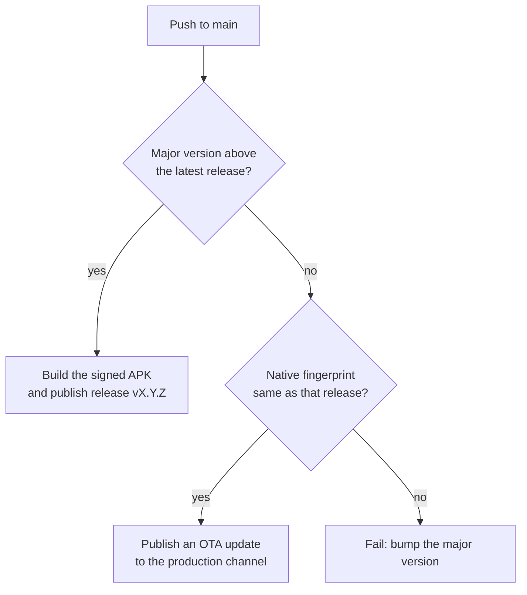

# Agent Notes

Context for coding agents working in this repo. Read [README.md](README.md) for layout and scripts first. Expo-specific rules live in [app/AGENTS.md](app/AGENTS.md).

## Where Things Stand

- Specs are HTML under [.docs/](.docs/): product requirements, POC requirements, and the POC task plan. Task IDs (T1, C2, A6, I1, …) come from [.docs/poc-tasks.html](.docs/poc-tasks.html), and branches are named after them (`a6-session-flow`). [.docs/minigames.html](.docs/minigames.html) shows which items have no minigame yet and the order to build the next ones. [.docs/subjects.html](.docs/subjects.html) covers the subjects beyond Math: where each Ontario program lives, how to fetch it, and which minigames fit.
- The design system lives in [.docs/design/](.docs/design/). Each component has a `README.md` and a `preview.html`. Tokens are in `tokens.json`.
- `SUBJECTS` and `FRAMEWORKS` in `shared/src/skill.ts` list every subject and its Ontario curriculum document. Parents only see `OFFERED_SUBJECTS`. Core and the packs carry only those subjects, so `bundle.json` can hold others before they ship. Add a subject there once its content is ready.
- `content/sources/<subject>/` holds each subject's curriculum text. `npm run content:sources` fetches all but math. The skill graph reads math, science, social studies, and health. See [content/sources/README.md](content/sources/README.md).
- `content/out/skills.json` holds the generated skill graph. `content/out/bundle.json` holds the generated stories and items. Generation and its checks live in `content/src/generate/`.
  - The graph covers math from Kindergarten, and science, social studies, and health from Grade 1, all to Grade 6.
  - Non-math ids carry a subject tag, like `g3-sci-`, `g4-soc-`, or `g5-hlth-`.
  - Non-math skills get tap-only fact items, and the reviewer checks every answer.
  - Skills with `parentOptIn`, such as Human Development and Sexual Health, stay out of core and the packs until the app has a parent switch for them. No other skill may depend on one.
  - The bundle covers the targets in `content/bundle-scope.json` plus their prerequisites. It holds math, science, social studies, and health.
- `content/scenes.json` maps item ids to sharing scenes, `content/slices.json` to slice scenes, `content/join.json` to join scenes, `content/compare.json` to compare scenes, `content/arrays.json` to array scenes, `content/grid.json` to grid scenes, `content/blocks.json` to base-ten blocks scenes, `content/stones.json` to stepping-stone runs, `content/lineup.json` to line-ups, `content/wall.json` to fraction walls, `content/label.json`, `content/order.json`, and `content/sort.json` to card scenes, and `content/hops.json` to frog paths on number lines. `npm run content:games -- --kind share|slices|join|compare|arrays|grid|blocks|stones|lineup|wall|label|order|sort|hops` writes one of them with one cached LLM call per skill, then adds it to the bundle. `content:scenes`, `content:slices`, `content:join`, `content:compare`, `content:arrays`, `content:grid`, `content:blocks`, `content:stones`, `content:lineup`, `content:wall`, `content:label`, `content:order`, `content:sort`, and `content:hops` are aliases. Each tagger declares its `subjects`, and only items of those skills reach it: math games see math, card games see science, social studies, and health. Code keeps a scene only when its answer matches the item's, so a regenerated item loses a stale scene.
- Fraction pictures say `picked`, not `shaded`, and name a `food` when the story does. The generator's prompts and cache still say "shaded". `content/src/generate/app-words.ts` rewords and picks the food after review, so cached calls keep their keys. It also fills a ten-frame with the thing its words count, such as stars, or the story's only object emoji. A ten-frame whose words say dots keeps dots.
- `npm run content:voices` renders 12 bundle lines with each TTS provider that has its keys in `.env`, into `content/out/voices/` (gitignored). Its `index.html` plays them under shuffled letters for a blind pick. The keys are `GOOGLE_TTS_API_KEY`, `AZURE_SPEECH_KEY` and `AZURE_SPEECH_REGION`, `ELEVENLABS_API_KEY` (and optional `ELEVENLABS_VOICE_ID`), and `OPENAI_API_KEY`. Clips already on disk aren't rendered again.
- Every bundle write also splits it into `content/out/packs/`: `core.json` with the skill graph, one pack per subject and grade, and `manifests/v<schemaVersion>/<coreHash>.json`. The files are minified because their hashes cover the exact bytes. Run `npm run content:packs` after editing `bundle.json` by hand, or a content test fails.
- The app ships `content/out/packs/core.json` and downloads the rest. `syncPacks()` in `app/src/content/` fetches the manifest for its core from `EXPO_PUBLIC_CONTENT_URL`, checks each pack's sha256, and saves it in the `content_packs` table. `loadContent(repo)` joins core with the downloaded packs. Each child gets their grade ±1, plus the grades placement or the trail reach next.
- Packs go up before the OTA update that reads them, so a build can meet content newer than its JS. It drops any `game` it can't parse and plays the item's own screen, and skips an item it still can't parse. So a new game kind, or a wider scene for an existing one, needs no schema bump.
- Bump `CONTENT_SCHEMA_VERSION` only when a build on the old JS couldn't play a pack even after dropping games, such as a renamed field every item has. Each build fetches only the manifest for its own version, so older builds keep the last content they can read until their OTA lands.
- Family devices run a release-signed APK from a GitHub release and get JS and content changes over the air. CI does both. See [Versions and Releases](#versions-and-releases) and [docs/install-android.md](docs/install-android.md).

## Code Map

- `shared/src/engine/` — learner engine: mastery, unlocks, next step. Pure TypeScript.
- `shared/src/placement/` — adaptive placement probe.
- `shared/src/speech/` — `toSpeech` reads math formatting aloud.
- `shared/src/scene.ts` — sharing scenes: what an item asks, its things and containers, and `sceneProblems`, which checks a scene against its item.
- `shared/src/slices.ts` — slice scenes: one food cut into equal slices that get picked, eaten, cut, shared, or compared. `sliceProblems` checks a scene against its item.
- `shared/src/hops.ts` — the frog's path along a number line after a check. `defaultHops` plans one from the line's start when an item has none.
- `shared/src/game.ts` — `GAMES`, the registry of minigames by `kind`. Each has its scene schema and the check `check-bundle` runs. An item plays at most one, in its `game` field.
- `content/src/games/` — the tagger runner and `TAGGERS`, one module per game: its candidates, LLM request, accept check, apply step, and reviewed file. A new game adds a module there.
- `shared/src/compare.ts` — compare scenes: pick the greatest, least, middle, or closer of 2 to 4 numbers, fractions, or decimals. `compareProblems` checks a scene against its item.
- `shared/src/arrays.ts` — array scenes: things in up to 10 × 10 rows and columns. Asks for the total, the rows, a row's size, a turn, or a split. `arrayProblems` checks a scene against its item.
- `shared/src/grid.ts` — grid scenes: tenths strips or hundred grids that fill an amount, read as a decimal, fraction, percent, or count of parts, or checked against a second amount. `gridProblems` checks a scene against its item.
- `shared/src/blocks.ts` — base-ten blocks scenes: flats, rods, and cubes that make a number up to 999, asking for the total, one place's count, a digit's worth, how many of a place it makes, or a second number added or taken away. `blocksProblems` checks a scene against its item and that the item names both numbers.
- `shared/src/stones.ts` — stepping-stone scenes: a run of 2 to 8 numbers or fractions with a fixed step and one missing. `stonesProblems` checks a scene against its item.
- `shared/src/lineup.ts` — line-up scenes: 2 to 8 animals or kids in a line, and the place an item asks about. The child finds the one in that place, or says which place it is. `lineupProblems` checks a scene against its item.
- `shared/src/wall.ts` — fraction walls: strips of halves to twelfths under one whole. The child fills a strip to match or just pass `than`, or compares `amount` with it, or picks the choice equal to it. `wallProblems` checks a scene against its item.
- `shared/src/sort.ts`, `order.ts`, and `label.ts` — card scenes for Science, Social Studies, and Health. Each asks one tap question with text choices: which bin a card goes in, which card fills a gap in a row, or which tag names a marked part of a picture. `shared/src/cards.ts` holds their shared card and checks. `PICTURES` in `label.ts` lists the pictures and their parts. Their taggers live in `content/src/label/`, `order/`, and `sort/`. The LLM writes each order row's other cards, so read `content/order.json` after a rerun.
- `shared/src/join.ts` — join scenes: things that come into a ten-frame, leave it, or get counted, set aside, or moved to make 10. `joinProblems` checks a scene against its item and its picture.
- `app/src/design/` — the design system in code: tokens, Baloo 2 and Atkinson Hyperlegible fonts, the line icons, and kid building blocks like `KidButton`, `KidScreen`, and `AvatarDisc`. Style new screens from here, not with raw colours.
- Kid-zone code imports `Text` from `app/src/design/Text`, not `react-native`. It swaps in Lexend for a child with the dyslexia-friendly font on, and ESLint enforces it.
- `app/src/session/` — the kid session controller: placement, then reviews, probes, and lessons. A finished check or review shows a `check-end` view before the next step. `buildTrail` picks the stops the child home draws.
- `app/src/storage/` — expo-sqlite with migrations and a Zod-validated repository. Tests run it on Node's SQLite (`storage/testing/`).
- `app/src/parent/` — PIN-gated parent area. `*.native.ts` files hold the phone versions. On web the PIN hash goes in the `settings` table, since expo-secure-store has no web support.
- `app/src/learning/` and `app/src/narration/` — item screens and expo-speech narration. After a check, the number line plays the frog's path, then shows the feedback.
- `app/src/learning/games.tsx` — `GAME_VIEWS`, the app's minigames by `kind`: each one's view, title, and demo items. `ItemView` plays an item's `game` from it instead of the item's usual screen.
- `app/src/learning/minigames/` — the sharing minigame and `GameFrame`, the prompt, answers, and feedback every minigame shares. Its `game.kind` is `share`. It allows retries during a lesson's check, and plays out the first answer then moves on when `measuring`.
- `app/src/learning/food/` — food art for fraction pictures, and the slices minigame (`slices`).
- `app/src/learning/join/` — the join-and-leave minigame on a pond, a bus, wires, or a tray (`join`).
- `app/src/learning/compare/` — the compare minigame (`compare`). Whole numbers to 20 build cube towers. Everything else drops flags on a number line.
- `app/src/learning/arrays/` — the arrays minigame (`arrays`). Rows and columns asks start empty and fill. Total, turn, and split asks show the whole array first.
- `app/src/learning/grid/` — the tenths and hundredths minigame (`grid`). Up to 4 strips or 2 hundred grids fill in a column at a time.
- `GameFrame`'s keypad gets a decimal point key when the item's answer is a decimal.
- `app/src/learning/blocks/` — the base-ten blocks minigame (`blocks`). After the answer, ten of a kind trade up, bigger blocks break down, and the asked place gets counted. An `add` ask's second number joins the mat, and a `take` ask breaks a block when a place runs short, then the blocks leave.
- `app/src/learning/stones/` — the stepping-stones minigame (`stones`). The frog hops the row from the bank, and the missing stone rises when it gets there. It shares its hop arcs with the number line through `app/src/learning/hopArc.ts`.
- `app/src/learning/lineup/` — the line-up minigame (`lineup`). The line walks in while the narrator counts its places, through `GameFrame`'s `intro`. A `find` line-up answers with a tap on the line, through `GameFrame`'s `stage` input. Its animals and kids are SVG art that faces the front.
- `app/src/learning/wall/` — the fraction wall minigame (`wall`). Fill and pass asks replace the keypad with a `build` input: the child taps, drags, or steps the lower strip to a dashed guide, then checks. Other asks fill both strips after the answer. `wallNarration` swaps keypad words like "Type the missing numerator" while the wall plays.
- `app/src/learning/cards/` — `CardGame` and the card stage pieces that `sort/`, `order/`, and `label/` share. A child taps a choice or drags it: the sort card goes into a bin, and an order or label choice goes onto its gap. After the answer, the picked card moves to its place. On a miss it shakes, then the right card takes the place. Label it's drawings and their part spots live in `label/pictures.tsx` and `label/layout.ts`.
- `/dev/learning` is a preview of every item type. `/dev/learning?all=1` plays every subject from the full bundle, which the dev pack server serves at `/dev/bundle.json`. Packs ship only offered subjects. `/dev/games/<kind>` plays a game's demo items, one per kind of question. `/dev/hops` does the same for frog paths. `/dev/check-end` shows each screen that ends a check or review. They show when `__DEV__` is true or the build sets `EXPO_PUBLIC_E2E=1`.

## Checking Your Work

Run what CI runs, in this order, before calling a task done:

```sh
npm run lint && npm run format:check && npm run typecheck && npm test && npm run build
```

To see the app, run `npm run dev` and open `http://localhost:8081`. It also serves `content/out/packs/` at `http://localhost:8090` for the app to download. Drive it with Playwright MCP and save screenshots under `.playwright-mcp/` (gitignored). The web build keeps its SQLite data in the browser, so clear site data for `localhost:8081` to start from a fresh install.

## Versions and Releases

The app version is `expo.version` in [app/app.json](app/app.json). Its major number is the runtime version, and an OTA update only reaches APKs with the same runtime version.

**Bump the major version in any PR that needs a reinstall.** That's any change to the native side:

- Adding, removing, or upgrading a package with native code (`npx expo install`).
- An Expo SDK or React Native upgrade.
- Changes to `app.json`, `app.config.js`, or config plugins, other than the version.

You don't have to spot these yourself. `scripts/release.mjs` compares the native fingerprint with the one saved in the latest release, and CI fails the PR if it changed without a major bump. Minor and patch bumps are optional. Use them to mark a change in **About this app**.



Before either path, `npm run content:publish` uploads the content packs to Cloudflare R2. Packs go first and the manifest last, so a manifest never names a missing pack. Add `-- --dry-run` to list the files without uploading.

CI needs these repo secrets:

- `EXPO_TOKEN`.
- The update signing key as `EXPO_UPDATES_PRIVATE_KEY`. Without it the OTA publish fails, since APKs from 3.0.0 on reject unsigned updates. [docs/install-android.md](docs/install-android.md#the-update-signing-key) covers the key and its rotation.
- The release key as `RELEASE_KEYSTORE` (base64), `RELEASE_STORE_PASSWORD`, `RELEASE_KEY_ALIAS`, and `RELEASE_KEY_PASSWORD`.
- An R2 API token with write access to the bucket, as `R2_ACCOUNT_ID`, `R2_ACCESS_KEY_ID`, `R2_SECRET_ACCESS_KEY`, and `R2_BUCKET`. Until all four are set, CI skips the upload with a warning. Setting only some fails the run. [docs/setup-r2.md](docs/setup-r2.md) shows where each value comes from.

The OTA publish and the family build also need the content host's https URL as the `EXPO_PUBLIC_CONTENT_URL` repo variable, and refuse to run without it.

## Gotchas

- **Stale `node_modules`.** Work often happens in `.claude/worktrees/`, which install their own deps. The main checkout can then miss packages a merged branch added, and Metro fails with `Unable to resolve "expo-crypto"`. `npm run dev` reinstalls when `package-lock.json` is newer than `node_modules/.package-lock.json`. Otherwise run `npm install`.
- **Port 8081 on Windows.** `Get-NetTCPConnection` can report Metro's listener with state `Closed`, and `netstat` may not list it at all. Find the owner by port, not by state.
- **Adding app deps.** Use `npx expo install <pkg>` from `app/`, never plain `npm install`, so versions match Expo SDK 58. If its npm call fails with `EALLOWSCRIPTS`, it has already written the versions to `app/package.json`, so run `npm install` from the root to finish.
- **ESLint 10.** `eslint-plugin-react` can't auto-detect the React version, so `eslint.config.mjs` pins it. Bump it there when React changes.
- **Curriculum text.** `content/sources/` stays byte-for-byte as fetched. Prettier ignores it. Don't reformat it.
- **LLM calls.** `npm run content:graph` and `npm run content:generate` use the Claude Code CLI in headless mode by default. Responses cache in `content/cache/llm/`, which is committed, so reruns are free unless a prompt changed.
- **OTA in e2e.** `app.config.js` turns updates off when `EXPO_PUBLIC_E2E=1`, so Maestro tests the JS the APK was built with.
- **Android e2e.** Windows builds need CMake 3.31+ and long paths on. See [e2e/README.md](e2e/README.md).
